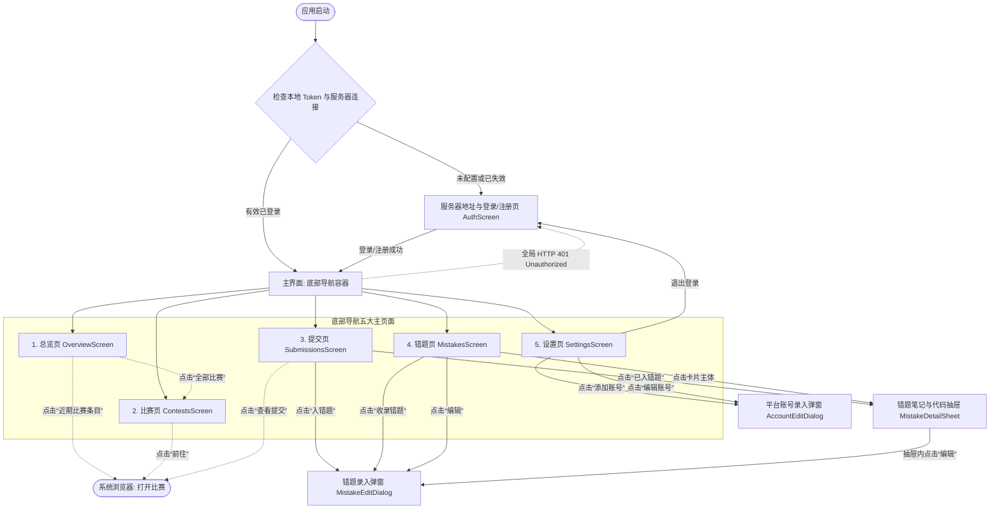

# OIBoard 移动端 UI 与交互架构设计方案 (UI_PLAN)

## 1. 移动端信息架构与底部导航设计

移动端采用标准的 **单 Activity + Navigation Compose** 架构。针对现有 Web 端的五大核心功能区，设计极简底栏导航（严格限制为 5 个核心入口），保证单手可操作性，操作热区优先沉降在屏幕下半部分。

```text
┌──────────────────────────────────────────────────────────┐
│                      OIBoard Mobile                      │
├──────────────────────────────────────────────────────────┤
│                                                          │
│                      主内容展示区                         │
│            (LazyColumn / 响应式状态下沉渲染)               │
│                                                          │
├──────────────────────────────────────────────────────────┤
│                        底部导航栏                         │
│  [ 总览 ]    [ 比赛 ]    [ 提交 ]    [ 错题 ]    [ 设置 ]  │
│  Overview    Contests   Submissions  Mistakes   Settings │
└──────────────────────────────────────────────────────────┘
```

### 1.1 底部导航栏设计 (Bottom Navigation Bar)
- **项数**：严格 5 项（Material 3 `NavigationBar` + `NavigationBarItem`）。
- **极简文案**：
  1. **总览**（图标：`Dashboard`，核心指标、近期比赛、年度热力图、统计图表）
  2. **比赛**（图标：`CalendarMonth`，比赛日程、实时动态倒计时、刷新与跳转）
  3. **提交**（图标：`FactCheck` / `ReceiptLong`，全量提交流、多维筛选、一键入错题）
  4. **错题**（图标：`MenuBook` / `Bookmark`，艾宾浩斯复习流、复习打卡、掌握状态、笔记）
  5. **设置**（图标：`Tune` / `Settings`，多平台多账号管理、同步代理、密码、主题、登出）
- **性能约束**：
  - 导航切换时利用 `saveState = true` 与 `restoreState = true` 保留滚动位置与必要输入状态；
  - 离开视图时释放大内存对象与图表实例，杜绝后台无界持有。

---

## 2. 页面跳转关系与路由图



---

## 3. 页面布局草图 (ASCII Sketch) 与设计规范

设计原则：**纯色背景（浅色 `#F8FAFC`，深色 `#000000` OLED 纯黑）、扁平扁平、无投影渐变、状态用色、触控目标 ≥ 48dp**。

### 3.1 首次启动 / 登录注册页 (`AuthScreen`)

```text
┌──────────────────────────────────────────┐
│  OIBoard                   [服务端设置 ⚙] │
├──────────────────────────────────────────┤
│                                          │
│             [ OIBoard Logo ]             │
│            算法刷题与比赛看板             │
│                                          │
│   [ 登录 ]            [ 注册 ]  (分段切换)│
│  ┌────────────────────────────────────┐  │
│  │ 用户名 (admin)                      │  │
│  ├────────────────────────────────────┤  │
│  │ 密码 (••••••)                      │  │
│  ├────────────────────────────────────┤  │
│  │ 确认密码 (仅注册模式显示)            │  │
│  ├─────────────────┬──────────────────┤  │
│  │ 验证码输入 (4位) │ [ CAPTCHA 图片 ] │  │ (点击刷新)
│  └─────────────────┴──────────────────┘  │
│                                          │
│  [            登 录 / 注 册           ]  │ (主色按钮)
│                                          │
│  当前后端: http://10.0.2.2:8888 (点击修改) │
└──────────────────────────────────────────┘
```

### 3.2 总览页 (`OverviewScreen`)

```text
┌──────────────────────────────────────────┐
│  总览                               [⟳] │
├──────────────────────────────────────────┤
│  ▼ 核心指标 (Bento 扁平卡片)              │
│  ┌─────────────────┬──────────────────┐  │
│  │ 通过题目   全平台 │ 今日通过     今日 │  │
│  │ 352 题          │ 4 题 (44% AC率)  │  │
│  │ CF:120 AT:62... │ 9 提交           │  │
│  ├─────────────────┼──────────────────┤  │
│  │ 连续打卡   连续 │ 累计提交     全量 │  │
│  │ 18 天           │ 1,420 次         │  │
│  └─────────────────┴──────────────────┘  │
│                                          │
│  ▼ 近期比赛 [全部 →]                      │
│  ┌────────────────────────────────────┐  │
│  │ [CF] Codeforces Round 980 (Div.2)  │  │
│  │ 10-30 22:35  |  倒计时: 1天 04小时 │  │
│  └────────────────────────────────────┘  │
│                                          │
│  ▼ 刷题热力图  [2026 ▼] [全部/CF/AT/LG]   │
│  ┌────────────────────────────────────┐  │
│  │ ■ ■ ■ ▨ ▨ □ □ □ ... 52周紧凑矩阵   │  │ (Canvas极低内存渲染)
│  │ 0 1-2 3-5 6-9 10+                  │  │
│  └────────────────────────────────────┘  │
│                                          │
│  ▼ 统计分析 [累计通过|每日提交|分类|平台] │
│  ┌────────────────────────────────────┐  │
│  │ 📈 累计通过爬坡折线图 (平滑/阶梯)   │  │ (原生 Canvas 绘制)
│  └────────────────────────────────────┘  │
└──────────────────────────────────────────┘
```

### 3.3 比赛页 (`ContestsScreen`)

```text
┌──────────────────────────────────────────┐
│  比赛日历                   [一键刷新 ⟳] │
├──────────────────────────────────────────┤
│  [全部] [Codeforces] [AtCoder] [洛谷]    │ (水平滑动胶囊)
│  [全部状态] [仅看进行中]   [🔍 搜比赛...] │
├──────────────────────────────────────────┤
│  ┌────────────────────────────────────┐  │
│  │ [CF] Codeforces Round 980 (Div.2)  │  │
│  │ 规则: Div.2 Rated (<=2100)         │  │
│  │ 开赛: 2026-10-30 22:35 (时长: 2h)  │  │
│  │ 倒计时: 1天 04:12:35       [ 前往 ] │  │ (动态倒计时)
│  └────────────────────────────────────┘  │
│  ┌────────────────────────────────────┐  │
│  │ [AT] AtCoder Beginner Contest 370  │  │
│  │ 规则: ABC Rated                    │  │
│  │ 开赛: 2026-11-02 20:00 (时长: 100m)│  │
│  │ 倒计时: 3天 01:30:00       [ 前往 ] │  │
│  └────────────────────────────────────┘  │
└──────────────────────────────────────────┘
```

### 3.4 提交流页 (`SubmissionsScreen`)

```text
┌──────────────────────────────────────────┐
│  提交记录 (1,420)              [重置 ↺] │
├──────────────────────────────────────────┤
│  日期: [全部] [今天] [7天] [30天] [自定义]│
│  平台: [全部平台 ▼]   状态: [全部状态 ▼] │
│  标签: [全部标签 ▼]   搜索: [🔍 题目/ID] │
├──────────────────────────────────────────┤
│  ┌────────────────────────────────────┐  │
│  │ [CF] 1800E2 - Unforgivable Curse   │  │
│  │ [AC] 1400分 | C++20 | 2小时前      │  │
│  │ 标签: greedy, dsu                  │  │
│  │ [入错题 ➕]                 [ 查看 ↗] │  │
│  └────────────────────────────────────┘  │
│  ┌────────────────────────────────────┐  │
│  │ [LG] P1001 - A+B Problem           │  │
│  │ [AC] 普及- | C++14 | 昨天          │  │
│  │ [已在错题集 ✓]             [ 查看 ↗] │  │
│  └────────────────────────────────────┘  │
├──────────────────────────────────────────┤
│  ◀ 上一页         第 1 / 29 页     下一页 ▶ │
└──────────────────────────────────────────┘
```

### 3.5 错题集页 (`MistakesScreen`)

```text
┌──────────────────────────────────────────┐
│  错题集                       [+ 收录]   │
├──────────────────────────────────────────┤
│  ┌──────────┬──────────┬────────┬───────┐│
│  │ 全部 35  │ 待复习 4 │ 训练中 │已掌握 ││ (Bento 状态卡)
│  │ 已录入   │ ! 到期   │ 22     │ 9     ││
│  └──────────┴──────────┴────────┴───────┘│
│  [全部] [待复习] [训练中] [已掌握] (分段) │
│  平台: [全部 ▼]  排序: [最新提交 ▼]      │
├──────────────────────────────────────────┤
│  ┌────────────────────────────────────┐  │
│  │ [CF] 1800E2 - Unforgivable Curse   │  │
│  │ 考点: 字符连通分量与并查集         │  │
│  │ 周期: 第 2 轮 | 剩余 3 天          │  │
│  │ [✓ 打卡复习] [已掌握] [编辑] [删除] │  │
│  └────────────────────────────────────┘  │
├──────────────────────────────────────────┤
│  ◀ 上一页         第 1 / 1 页      下一页 ▶ │
└──────────────────────────────────────────┘
```

### 3.6 错题笔记与代码查看抽屉 (`MistakeDetailSheet`)

```text
┌──────────────────────────────────────────┐
│  [拖动条]                                │
│  [CF] 1800E2 - Unforgivable Curse        │
│  难度: 1400  |  标签: greedy, dsu        │
├──────────────────────────────────────────┤
│  复习进度: 第 2 轮 (下次: 2026-11-04)    │
│  状态: 训练中 (剩余 6 天)                 │
├──────────────────────────────────────────┤
│  [考点错因]                              │
│  利用字符自由度交换构建并查集，判断连通性│
│                                          │
│  [解题笔记与核心代码]                     │
│  ```cpp                                  │
│  for (int i = 0; i < n; i++) {           │
│      if (i + k < n) merge(i, i + k);     │
│      if (i + k + 1 < n) merge(i, i+k+1); │
│  }                                       │
│  ```                                     │
├──────────────────────────────────────────┤
│  [ 打卡复习 ]  [ 标记已掌握 ]  [ 编辑笔记 ]│
└──────────────────────────────────────────┘
```

### 3.7 设置与账号管理页 (`SettingsScreen`)

```text
┌──────────────────────────────────────────┐
│  设置与账号                              │
├──────────────────────────────────────────┤
│  ▼ 当前登录                              │
│  admin (管理员) | 服务端: 10.0.2.2:8888  │
│  [ 退出登录 ]                            │
│                                          │
│  ▼ 平台账号绑定                          │
│  ┌────────────────────────────────────┐  │
│  │ Codeforces               [+ 添加]  │  │
│  │ • tourist (主账号) [同步] [验证] [⁝]│  │
│  │ • tourist_alt      [设为主账号] [⁝]│  │
│  ├────────────────────────────────────┤  │
│  │ AtCoder                  [+ 添加]  │  │
│  │ 洛谷 (Luogu)              [+ 添加]  │  │
│  │ AcWing                   [+ 添加]  │  │
│  │ 力扣 (LeetCode)           [+ 添加]  │  │
│  └────────────────────────────────────┘  │
│                                          │
│  ▼ 同步与网络代理                        │
│  轮询间隔 (分钟): [ 30 ]                 │
│  冲刺高频轮询: [ 开关 ● ]                │
│  出站代理: [ http://127.0.0.1:7890     ] │
│  [ 保存配置并全量同步 ]                  │
│                                          │
│  ▼ 安全设置                              │
│  [ 修改登录密码 ]                        │
│                                          │
│  ▼ 外观设置                              │
│  [ 跟随系统 ]   [ 极简浅色 ]   [ 纯黑深色 ]│
└──────────────────────────────────────────┘
```

---

## 4. 交互与状态规范

1. **触控与视觉反馈**：
   - 所有按钮、条目与卡片点击区域最小保持 48dp × 48dp。
   - 所有网络请求按钮自带 loading 指示器与防重复点击保护。
2. **极简空态、加载与错误态**：
   - 骨架屏：不采用昂贵的 Shimmer 动画，使用纯色半透明轻量占位条。
   - 空态：一个灰度轮廓图标 + 极短文字（2~4 字，如“暂无错题”）。
   - 错误态：一个告警图标 + 错误简讯 + 一个扁平“重试”按钮。
3. **低 CPU / 低 GPU 图表渲染策略**：
   - 不引入体积与内存开销巨大的第三方 WebView 图表库。
   - 统计图表（折线图、柱状图、环形图）与打卡热力图采用纯原生 Jetpack Compose Canvas 绘制。
   - 绘制时只重组必要的数据状态，使用 `remember` 缓存 Path 路径，杜绝帧率抖动。
